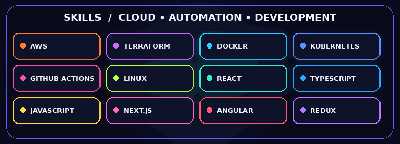
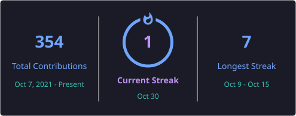

# Upendra Eemani

### DevOps Engineer · Cloud Infrastructure · Automation

**DevOps Engineer at TCS** · Hyderabad, India

I build reliable cloud infrastructure and delivery workflows through automation, infrastructure as code, and thoughtful operational practices. I also enjoy developing web applications and exploring the tools that help teams ship with confidence.

  

[Repositories](https://github.com/Upendra2024?tab=repositories) · [Activity](https://github.com/Upendra2024?tab=overview)

---

## About

I’m a DevOps Engineer at TCS based in Hyderabad, India. My work and learning focus on cloud infrastructure, infrastructure as code, CI/CD automation, containers, and dependable software delivery. I also build frontend applications with React, TypeScript, JavaScript, Next.js, Angular, and Redux.

- **Build:** repeatable infrastructure and deployment workflows
- **Improve:** delivery speed, reliability, and operational visibility
- **Explore:** cloud-native practices and hands-on automation projects

## At a glance

| Role | Location | Focus | Exploring |
|---|---|---|---|
| DevOps Engineer at TCS | Hyderabad, India | Cloud, automation, CI/CD | AWS, Terraform, Kubernetes, observability |

## Skills & technology

**Tooling icon grid**

## Featured repositories · live

A hand-picked project grid with short portfolio descriptions. Repository cards and star/fork counters are fetched live from GitHub.

| Infrastructure & platform engineering | GitOps & application delivery |
|---|---|
| **[Jenkins Terraform EKS](https://github.com/Upendra2024/Jenkins-Terraform-EKS)**   Infrastructure automation with Terraform, Jenkins, and Amazon EKS.        | **[GitOps Register App](https://github.com/Upendra2024/gitops-register-app)**   A GitOps-oriented application deployment practice project.        |
| **[Python for DevOps](https://github.com/Upendra2024/python-for-devops)**   Python practice focused on DevOps learning and automation.        | **[Register App](https://github.com/Upendra2024/register-app)**   A full-stack registration application project.        |

[Explore all repositories](https://github.com/Upendra2024?tab=repositories)

## Recent writing

New posts from my RSS feed are added here automatically. Configure the public repository variable `BLOG_FEED_URL` with your site's RSS or Atom feed URL to turn on syncing.

<!-- BLOG-POST-LIST:START -->
<!-- BLOG-POST-LIST:END -->

The blog-sync workflow checks the feed daily and can also be run manually from the repository’s **Actions** tab.

## GitHub stats · live

| GitHub statistics | Top languages |
|---|---|
|  |  |

| Auto-refreshed streak | Profile summary |
|---|---|
|  |  |

| Repositories by language |
|---|
|  |

### GitHub achievements

### Contribution activity

*The visitor counter reflects image requests, not a verified count of unique people.*

## Current focus

- Strengthening AWS and cloud engineering practices
- Building infrastructure with Terraform and Kubernetes
- Automating delivery pipelines with GitHub Actions
- Improving observability, security, and operational feedback loops

## Engineering principles

> Automate the repeatable. Make systems observable. Improve through feedback.

I value reliability over heroics, infrastructure as code over manual changes, and small, repeatable releases over risky deployments—with security and operational visibility considered from the start.

---

### Let’s build reliable systems together.

Thanks for stopping by. Explore my [repositories](https://github.com/Upendra2024?tab=repositories) and [recent activity](https://github.com/Upendra2024?tab=overview).

